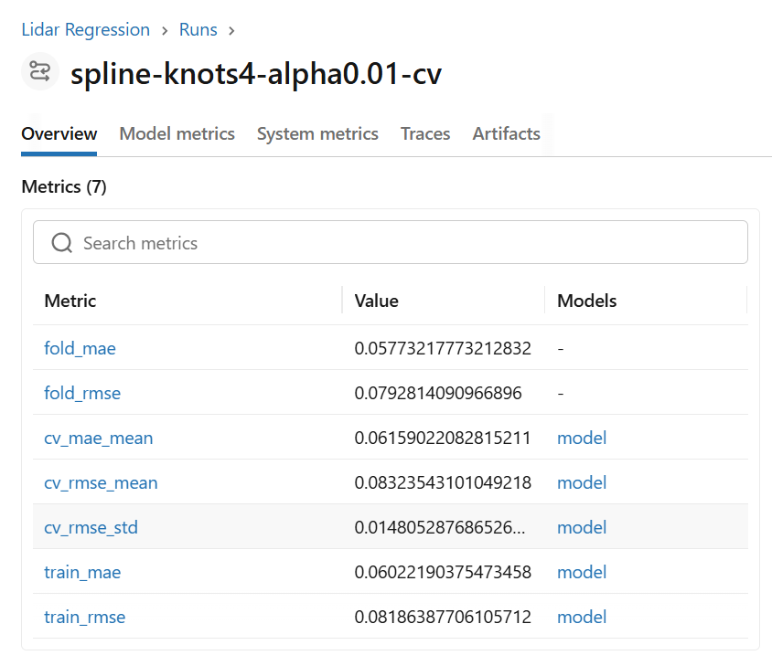
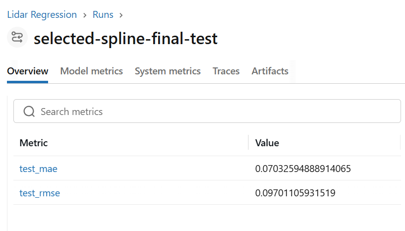
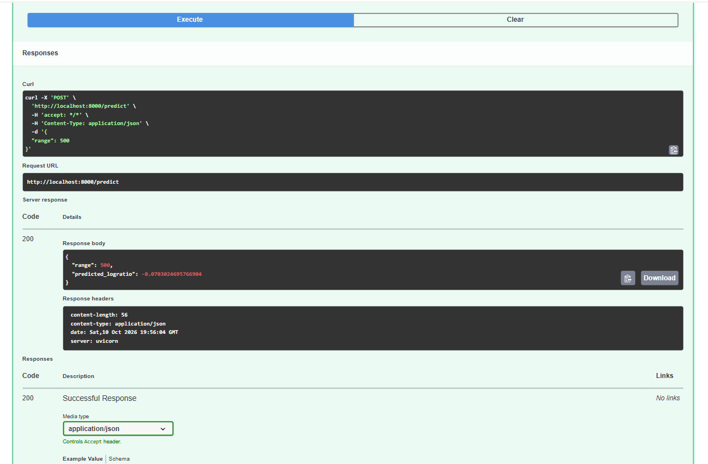

# Lidar Regression with MLflow and FastAPI

A learning project developed from Advanced Statistical Methods coursework,
extended with Python model comparison, MLflow experiment tracking, and a
tested local prediction API.

The project predicts `logratio` from `range` using linear regression and
regularized cubic spline models.

## Dataset

`data/lidar.dat` contains 221 observations with two columns:

- `range`: input measurement.
- `logratio`: numerical response to predict.

The dataset was supplied with the coursework. Its original provenance and
redistribution terms still need to be documented.

## Methods

The data were split into:

- 176 training observations.
- 45 held-out test observations.

Model selection used five-fold shuffled cross-validation on the training
data, with seed 42. All candidates used identical folds.

Models compared:

- A constant baseline predicting the training mean.
- Linear regression.
- Cubic spline features followed by Ridge regression, with:
  - `n_knots`: 4, 6, or 10.
  - `alpha`: 0.01 or 1.0.

Spline transformations were fitted within each training fold using a
scikit-learn pipeline.

## Results

### Cross-validation

| Model | Mean MAE | Mean RMSE | RMSE standard deviation |
|---|---:|---:|---:|
| Mean baseline | 0.258385 | 0.281477 | 0.029030 |
| Linear regression | 0.104498 | 0.126799 | 0.016991 |
| Spline: 4 knots, alpha 0.01 | 0.061590 | 0.083235 | 0.014805 |
| Spline: 4 knots, alpha 1.0 | 0.066960 | 0.087544 | 0.019622 |
| Spline: 6 knots, alpha 0.01 | 0.057281 | 0.079956 | 0.013378 |
| Spline: 6 knots, alpha 1.0 | 0.059325 | 0.082069 | 0.017684 |
| Spline: 10 knots, alpha 0.01 | 0.052609 | 0.075627 | 0.017651 |
| Spline: 10 knots, alpha 1.0 | 0.055952 | 0.077862 | 0.021944 |

The selected candidate used 10 knots and `alpha=0.01`. Its mean validation
RMSE was approximately 40.4% lower than that of linear regression.

### Held-out test

The selected saved model was evaluated without retraining:

| Metric | Value |
|---|---:|
| Test MAE | 0.070326 |
| Test RMSE | 0.097011 |

MAE and RMSE are expressed in units of `logratio`, not percentages.
The test results apply to this single 45-observation split.

The random split evaluates prediction within the sampled range.
It does not establish performance on independent measurement campaigns
or extrapolation beyond the training range.

## Project files

| File | Purpose |
|---|---|
| `train_baseline.py` | Train and log a linear regression baseline |
| `compare_models.py` | Compare the mean baseline and linear regression |
| `compare_splines.py` | Compare spline candidates, save models, and verify reloading |
| `api.py` | Serve predictions through FastAPI |
| `test_api.py` | Check API readiness, a reference prediction, and invalid input |
| `requirements.txt` | Package versions captured from the development environment |
| `python-version.txt` | Python version used during development |
| `data/lidar.dat` | Coursework dataset |

The final test evaluation was executed interactively and logged in MLflow;
it is not yet included as a standalone script.

## Setup

The original environment used Python 3.14.6 and MLflow 3.17.0.
The requirements file records the installed environment, including
dependencies used for earlier MLflow exercises.

From the repository root:

```bash
python3 -m venv .venv
source .venv/bin/activate
python -m pip install --upgrade pip
python -m pip install -r requirements.txt
```

## Run the experiments

Start MLflow in one terminal:

```bash
mlflow server --host 127.0.0.1 --port 5000
```

Keep that terminal running. In another terminal, activate the environment
and execute:

```bash
source .venv/bin/activate
python train_baseline.py
python compare_models.py
python compare_splines.py
```

Open http://localhost:5000 and select the `Lidar Regression` experiment.

MLflow records parameters, metrics, fold results, fitted-curve plots,
and saved models. Each execution creates new runs and model IDs.

Spline models use the skops serialization format with an explicit list
of the SciPy spline types used by the pipeline.

## Run the prediction API

The current API loads a specific saved model from the author's local
MLflow server. That model and the MLflow database are not included in
this repository.

Before starting the API on another machine:

1. Run `compare_splines.py` to create the models locally.
2. Copy the selected model URI printed by the script.
3. Replace `MODEL_URI` in `api.py` with that URI.

Keep MLflow running and start the API from the repository root:

```bash
python -m uvicorn api:app --host 127.0.0.1 --port 8000
```

Open http://localhost:8000/docs to use the interactive API documentation.

### Endpoints

- `GET /health`: reports whether the API is ready.
- `POST /predict`: accepts a numerical `range` and returns a prediction.

Example request:

```json
{
  "range": 500.0
}
```

Example response from the selected model:

```json
{
  "range": 500.0,
  "predicted_logratio": -0.0703024695766904
}
```

This is a local demonstration, not a production deployment.

## Test the API

With the API running, execute in another terminal:

```bash
python test_api.py
```

The checks verify:

- API readiness.
- A finite prediction matching the current model's reference output.
- Rejection of invalid input with HTTP status 422.

The reference prediction is model-specific. If the model changes,
review and update that check.

These checks verify software behavior; statistical performance is assessed
separately through validation and held-out testing.

## Implemented MLOps practices

- Git version control.
- MLflow experiment tracking.
- Reproducible data splits and validation folds.
- Pipeline-based preprocessing.
- Model serialization and reload verification.
- Local API serving and automated API checks.
- Recorded package versions.

## Next steps

- Document dataset provenance and redistribution terms.
- Add a standalone final-evaluation script.
- Export the selected model for serving without a tracking server.
- Add Docker packaging.
- Add continuous integration.
## Screenshots

### Model comparison


### Final test results


### API prediction
